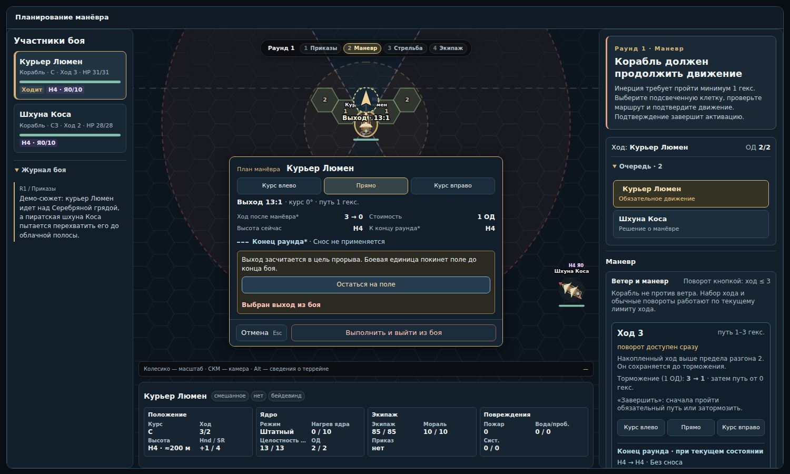

# Предсказуемый манёвр — 13 октября 2026

Изменения продолжают [проверку ветра и инерции](wind-inertia-audit-2026-10-11.md). База: `8446f8336436238bae9de0177d76e439e299c387`.

## Что изменилось для игрока

### Ход против ветра

Нос против ветра обнуляет доступную тягу парусов, но сохраняет накопленный ход. Это действует при повороте кнопкой, повороте в маршруте, смене ветра и фазы. Неудачная попытка добавить паруса тоже не меняет скорость.

После неудачного выхода из положения против ветра теряются обычные 2 единицы хода; накопительная помощь +2 к следующей попытке сохранена. Штраф бюджета до 1 ОД применяется только к уже остановившемуся кораблю. Движущийся корабль сохраняет возможность подготовительного действия и обязательного движения.

Пример: ход 4 перед сменой ветра остаётся 4; ход 3 после неудачного выхода из ветра становится 1. Короткий маршрут и обычное торможение по-прежнему гасят инерцию. Самопроизвольное горизонтальное замедление и отдельный вектор скорости не добавлены.

### Граница поля и выход

| Ситуация | Результат |
| --- | --- |
| Минимальный путь длиннее расстояния до края | Можно выбрать короткий маршрут до крайней клетки; ход станет 0. Клетка подписана «Край» |
| Перед носом сразу край и нет допустимых маршрутов | Завершение активации останавливает участника без урона от границы |
| Ветер несёт за край | Снос заканчивается в последней клетке поля. Ход сохраняется; автоматического выхода нет |
| На пути скала, опасный террейн или другой участник | Существующие правила столкновений и повреждений сохраняются |
| Летун без зависания остановился в воздухе | Обычное сваливание остаётся; прогноз предупреждает о потере высоты |
| Достигнут нужный край сценария прорыва | Выход ещё нужно явно выбрать и подтвердить |
| Выход через другой край или другой стороной | Отступление, которое не засчитывается как прорыв |

На краю в панели доступен черновик «Выйти из боя». В маршруте, заканчивающемся на краю, можно выбрать выход после движения. По умолчанию участник остаётся на поле. Выбор другого маршрута сбрасывает намерение выйти, поэтому оно не переносится незаметно на другой край.

Выход из крайней клетки — отдельное тактическое решение за 1 ОД движения, без добавочного гекса и требования к направлению носа. В составе уже выбранного маршрута дополнительное ОД не требуется. При обязательном движении с исчерпанными ОД сохраняется существующее исключение для манёвра за 0 ОД. Выход завершает активацию, убирает участника с поля и из доступных целей; он остаётся в списке участников с признаком выхода. Итог сценария по-прежнему проверяется при расчёте конца раунда.

Сцепление, буксировка, прикрепившееся существо, падение, обездвиживание и блокирующие обломки не позволяют добровольно выйти. Если повреждения в пути помешали выходу, движение сохраняется, а журнал объясняет, почему выход не выполнен.

Паника ИИ остаётся отдельным правилом бегства. Она теперь помечается как бегство и не выполняет цель прорыва. Старые сохранённые успешные выходы без нового признака типа выхода продолжают учитываться.

### Черновик манёвра

- «Курс влево / Прямо / Курс вправо» выбирают допустимый маршрут с нужным конечным курсом. При переключении сохраняется близкая длина пути; дистанцию можно уточнить кликом на поле.
- «На месте влево / вправо» открывают черновик поворота на 60°. Видны 1 ОД, ожидаемый курс, ход и требуемая проверка. При высокой скорости эти кнопки недоступны; используется маршрут с отложенным поворотом.
- Поворот на месте расходует подготовительное действие. Поворот в маршруте входит в действие движения и использует прежние правила задержки. Эти различия подписаны в прогнозе.
- До подтверждения нет движения, расхода ОД, бросков и записей в журнале. Отмена и Escape убирают черновик.
- На узком окне создание черновика переключает на поле, где видны прогноз и подтверждение.
- После поворота активация продолжается, если остаются ОД; после движения или выхода завершается.

Стоимость движения, формулы задержки и проверки поворота в маршруте не менялись: прежний поворот внутри маршрута не требует отдельного броска. Полное объединение правил двух видов поворота потребовало бы определения последствий провала в середине пути; этот PR объединяет их предварительный просмотр и подтверждение, сохраняя указанную разницу в правилах.

## Проверки

- Регрессии сохранения инерции при смене ветра, попытке разгона, повороте и провале проверки.
- Сопоставление прогноза с выполненным движением, включая остановку у края и движение с выходом.
- Снос кораблей и существ во всех шести направлениях, настоящие препятствия, ограничение добровольного выхода и различие прорыва/отступления/бегства ИИ.
- Отмена, устаревший черновик, повторное подтверждение, отказ записи, нормализация сохранения и списание ОД.
- Chromium: реальные обработчики приложения, переключение курса, отмена поворота, неудачная проверка, выход из текущей клетки и после маршрута, выход существа. Размеры 1500×900, 1100×900, 800×900, 800×650.
- Существующие проверки всех рабочих панелей, стрельбы, экипажа, ветра и эффектов также проходят.

Браузерные проверки используют настоящие шаблоны и контроллеры с тестовой оболочкой и хранением Foundry. Реальную сетевую сессию они не воспроизводят. Дополнительные циклы анимации и обработка на каждом кадре не добавлены.

## Пример

