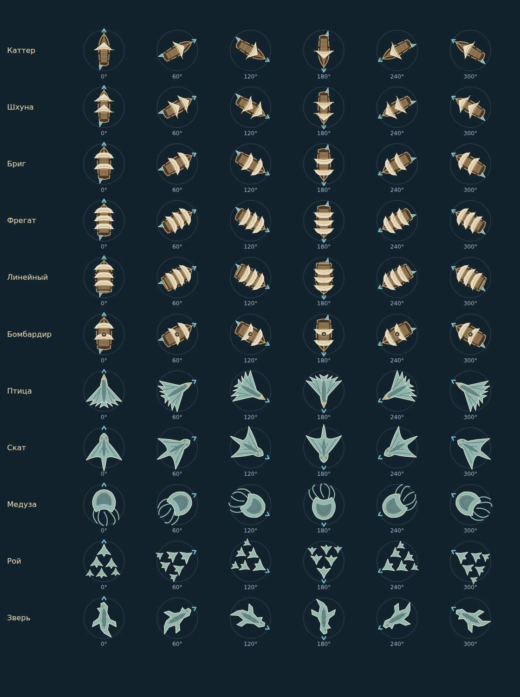
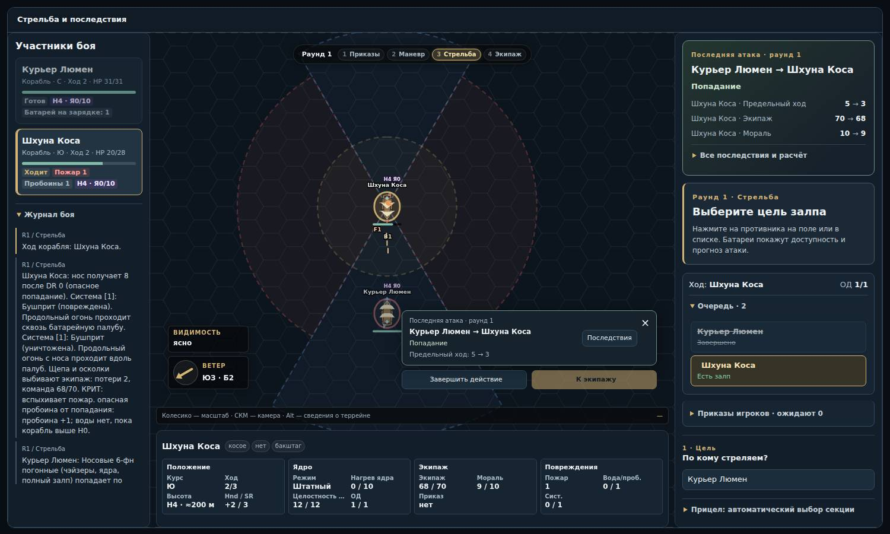
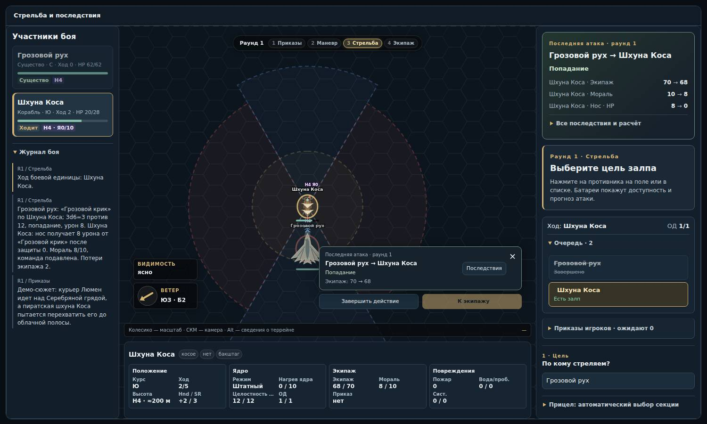

# Примеры нового визуала

Реальные скриншоты браузерного стенда из PR #8 и #9. Это статичные кадры; короткие эффекты в игре движутся.

## Корабли и существа на шести курсах

Шесть корабельных силуэтов и пять типов существ. Столбцы: 0°, 60°, 120°, 180°, 240°, 300°. Голова и нос направлены к цветному указателю.

[Открыть изображение целиком](fleet-directions.jpg)

## Корабельный залп

Следы снарядов, пожар на цели и отчёт о последствиях.

[Открыть изображение целиком](cannon-flight.jpg)

## Атака грозового руха

Силуэт крупной птицы и звуковая атака по кораблю.

[Открыть изображение целиком](creature-attack.jpg)

