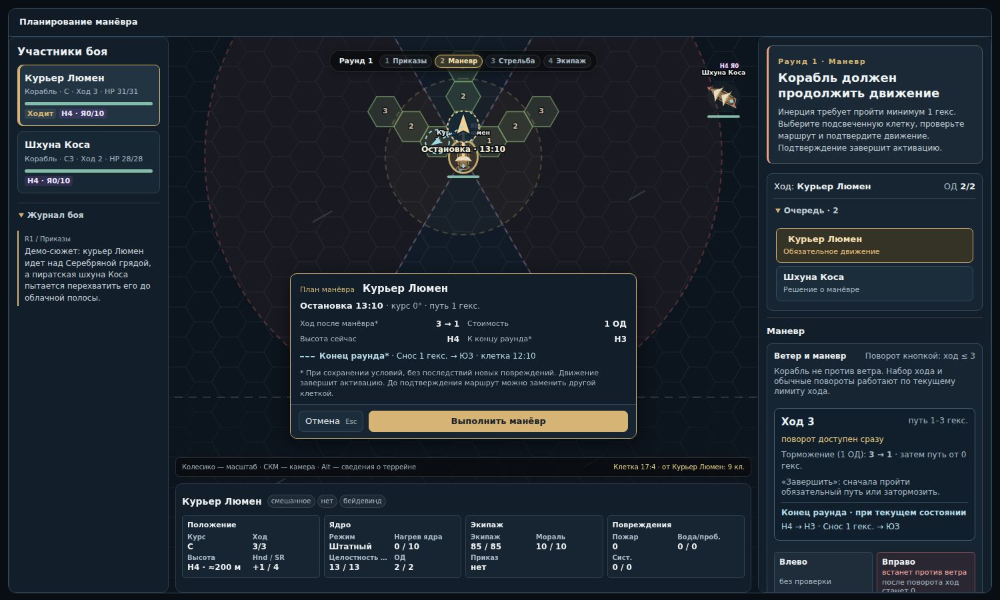

# Ветер и инерция: проверка 11 октября 2026

Проверена версия main `910ce37fcc76102c99f7c882315051b74701fcd5`. Изменения этого PR исправляют отображение и объясняют существующие правила; формулы движения, стоимость действий и баланс не меняются.

## Ветер: что было неверно

Направление было правильным. В данных `wind.direction` означает **куда** дует ветер; источник находится на 180° напротив. В SVG ось X смотрит вправо, поэтому нужен поворот `direction − 90°`. Это согласуется с шестью направлениями перемещения по гексам. Подпись одного направления не объясняла эту договорённость.

Видимость была сломана раскладкой частиц. После уменьшения их числа осталась старая формула `y = (i × 137 + 53) % (height × 3) − height`. На высоких картах большинство полос оказывались вне поля. При панорамировании и приближении слой не следовал за камерой. Пробег зависел от размера всей карты, поэтому одинаковая сила ветра выглядела по-разному. Полосы рисовались над кораблями и интерфейсными обозначениями.

Теперь:

- Поток размещён в координатах видимой области с равномерными поперечными дорожками. Масштаб одинаков по X и Y, поэтому направление не искажается.
- Ветер имеет 10/12/14/16 полос для слабого/умеренного/сильного/штормового режима. Штиль, экономный режим, отключённые эффекты и reduced motion не создают полос.
- На камеру приходится постоянная плотность и темп. Панорамирование и масштаб меняют один SVG transform, не создавая узлы и не запуская JS-анимацию. При изменении пропорций окна перенастраиваются те же полосы; учитывается дополнительное пространство SVG с preserveAspectRatio=meet.
- Полосы находятся под кораблями; нет фильтров и смешивания screen. Тень, турбулентность, полноэкранный шум и системы частиц не добавлены.
- Виджет показывает «СВ → ЮЗ» и силу словами. Стрелка означает направление сноса. При штиле стрелка скрыта.
- Переключение reduced motion обновляет слой в обе стороны, включая случай запуска окна с уже включённым reduced motion. Скрытое окно использует существующую остановку SVG-анимаций.

Это фоновая подсказка общего ветра, а не физическая карта локальных воздушных потоков. Нисходящие потоки остаются отдельным террейном.

## Инерция: действительная модель

| Слой | Как работает сейчас | Что нужно понимать игроку |
| --- | --- | --- |
| Горизонтальный ход | Хранится между раундами; предел тяги ограничивает разгон | Потеря парусов или попутного ветра обычно не стирает уже набранную скорость |
| Обязательный путь | Для корабля: max(0, ход − торможение) | Это минимум длины маршрута, а не обязательно путь прямо |
| Короткий маршрут | Ход после движения уменьшается до длины выбранного маршрута, затем применяются последствия | Манёвр уже включает торможение; отдельное действие торможения может дополнительно уменьшить ход |
| Поворот на поле | На высокой скорости сначала несколько гексов прямо, затем один поворот 60° | Не путать с кнопкой мгновенного поворота |
| Поворот кнопкой | Блокируется выше безопасного хода; выход из положения против ветра может требовать броска | Надпись «без проверки» была неверной |
| Завершение без маршрута | При допустимом остаточном ходе ставит скорость 0 и оставляет на месте | Это не автоматическое продвижение по инерции |
| Вертикаль корабля | Применяется в конце раунда; обычная скорость затем делится пополам с округлением к 0 | +1 H/раунд действует один раз; +2 обычно даёт +2, затем +1, если не достигнут потолок |
| Падение | Имеет отдельные правила ускорения и удара | Для существ сваливание без хода означает −2 H за раунд |
| Ветровой снос | Отдельное смещение после вертикали | Это не часть выбранного пути и не поворот носа |

Нормальный корабль с прямым вооружением тормозит на 1, с косым или смешанным — на 2. Шторм, приказ, повреждения и экипаж влияют на профиль, но результат ограничен снизу единицей. Поэтому штраф «−1 к торможению» у корабля с исходным торможением 1 фактически ничего не меняет.

Размер влияет на безопасный поворот уже при SM8/SM9. Дополнительный штраф массы к разгону/торможению начинается с SM10, тогда как стандартные корабли находятся ниже этого порога. Чувство тяжести сейчас создают главным образом вооружение, управляемость и задержка поворота.

Проверяемый пример на чистом поле: SM7, управляемость 1, ход 4, умеренный ветер, приказ не выбран.

| Вооружение | Минимальный путь | Прямо до поворота на поле | После торможения | Можно завершить на месте после торможения |
| --- | ---: | ---: | --- | --- |
| Косое / смешанное | 2 | 1 | ход 2, минимум пути 0 | Да, ход станет 0 |
| Прямое / тяжёлое прямое | 3 | 2 | ход 3, минимум пути 2 | Нет |

При развороте носом к источнику ветра тот же ход 4 сразу становится 0. У северной границы карты корабль с прямым вооружением и ходом 4 при завершении получает 8 урона в нос и останавливается. Это результаты вызова существующего движка в `audit-inertia.mjs`, а не предположения о поведении.

Существа используют собственные профили. Не умеющий зависать летун на любом положительном ходе обязан пройти хотя бы один гекс, а остановка в воздухе приводит к сваливанию. У зависающих видов обязательного продвижения нет. Падающее существо в этот раунд не получает обычный ветровой снос. Прицепившееся следует за носителем.

## Что игрок теперь видит

В панели движения показаны фактический ход, диапазон маршрута, результат действия торможения и обязательный путь после него. Рядом объяснено, что сделает «Завершить», включая аварийную остановку с уроном при отсутствии маршрутов. Существа получают ту же структуру подсказок с предупреждением о сваливании.

На поле до выбора маршрута сплошной золотистый отрезок показывает путь прямо до возможного поворота. Он строится по существующим допустимым маршрутам и не проходит сквозь блокирующий террейн.

После выбора клетки отдельно показаны:

1. Маршрут и остановка после манёвра.
2. Ход после манёвра.
3. Высота и снос в конце раунда. Пунктир ведёт от предполагаемой остановки к позиции после сноса.

Прогноз условный: ветер, позиции других участников и повреждения ещё могут измениться. Препятствия проверяются на ожидаемой высоте после вертикального движения. Посадка может повредить системы и изменить снос, поэтому для неё не обещается точная конечная клетка. Прогноз не бросает кубики, не применяет урон, не резервирует клетки и не меняет бой.

## Что предложено изменить в правилах следующим этапом

**Первым — согласовать поведение против ветра с сохранением инерции.** Сейчас `syncInIronsFlag` и `resolveTurn` немедленно ставят ход 0. Это создаёт возможность резкого торможения разворотом и противоречит сохранению хода при остальных потерях тяги. Предлагаемый вариант: тяга 0, накопленный ход сохраняется, затем гасится обычным торможением. Состояние «нос против ветра» и выход из него сохраняются. Потребуются отдельная проверка последствий для ИИ, маршрутов и темпа боя.

**Затем — явное правило края карты.** Сейчас при отсутствии маршрутов край поля обрабатывается как столкновение с уроном, а при сносе также повреждает корпус. Игрок скорее ожидает выход из боевой зоны или остановку у границы. Лучше отдельное решение «покинуть бой» с учётом сценария и преследования; край экрана не должен неявно становиться скалой.

**Торможение стоит проверять как бюджет активации.** Корабль с ходом 4 и торможением 2 может отдельным действием снизить ход до 2, затем завершить активацию на месте. Это допускают нынешние правила; не следует представлять торможение 2 как общий предел потери скорости за раунд. Прежде чем вводить единый бюджет, стоит сравнить длительность боёв: запрет двойного торможения может усилить тяжеловесность, от которой мы уже уходим.

**Повороты лучше постепенно собрать в одном планировщике.** Кнопка поворота и маршрут сейчас имеют разную семантику. Предлагаемый интерфейс: менять курс в черновике маршрута, сразу показывая задержку, проверку и потерю хода; подтверждать одним действием. Это более значимое улучшение ясности, чем полная физическая модель.

Полную векторную скорость с независимым боковым движением пока не рекомендую: она добавит ещё одну величину, изменит коллизии и ИИ, увеличит число решений. Для ощущения тяжёлого воздушного корабля достаточно понятных задержки поворота, торможения и прогноза.

## Воспроизводимость и ограничения

- `npm run check`: проверки модуля и регрессии, включая сравнение прогноза с реальным концом раунда, замороженное состояние и запрет случайных бросков.
- `node tools/audit-inertia.mjs`: численные примеры существующих правил; отчёт `artifacts/inertia/audit.json`.
- `node tools/preview-wind-inertia.mjs`: Chromium, настоящие шаблоны и контроллер камеры, переключение reduced motion, выбор маршрута, 54 сочетания размера карты/масштаба/направления.
- `artifacts/interface/wind-audit.json`: видимость старого и нового слоя и замеры изолированного SVG-ветра. Старая функция взята из проверенной версии main.
- Остальные браузерные проверки охватывают окна 800×650–1500×900, все рабочие панели, движение, стрельбу, экипаж и эффекты.

Браузерные проверки подменяют оболочку и хранение Foundry. Измерения CI не являются обещанием FPS на компьютере игрока; живую многопользовательскую сессию они не воспроизводят.

### Измерения

Проверенный прогон после учёта фактического размера SVG: [GitHub Actions](https://github.com/Mishokkka/fbl-sailship-combat/actions/runs/38123969601). Все 175 тестов и браузерные проверки прошли.

В 54 сценариях слабого ветра старая раскладка имела **30 случаев с нулём видимых полос** во всех 16 временных выборках. У новой во всех сценариях видно в среднем не менее **5,13 полос**. На карте 5000×4000 при масштабе 1 старая раскладка не показывает ни одной полосы во всех шести направлениях; новая показывает в среднем 5,13–9,56.

При изолированном штормовом ветре и масштабе 1: старая раскладка содержит 30 SVG-узлов (14 полос с учётом LOD), новая — 34 (16 полос). В двух замерах по 1,2 секунды TaskDuration старой составил 33,68–35,39 мс, новой — 18,56–19,59 мс. 95-й процентиль интервала кадров у обеих — 16,8 мс. Это ограниченный замер геометрии/анимации под общей CSS-оболочкой, а не доказательство выигрыша FPS во всей игре. Пиковый бюджет полос уменьшен с 20 до 16; при прежнем LOD среднее число узлов иногда было меньше, но поток мог исчезнуть совсем.

В рабочем коде нет нового requestAnimationFrame или таймера на ветер: движение выполняет SVG. Прогноз строится только при подготовке контекста, ветровой путь ограничен двумя гексами.

## Пример из браузера

Слева на поле — выбранный маршрут и пунктир сноса; в карточке отдельно указаны ход после манёвра и положение в конце раунда. Справа — торможение и правила завершения активации. Скриншот получен настоящими шаблонами и контроллерами модуля в Chromium; оболочка Foundry подменена тестовой.

